# Администратор Linux. Professional
## Занятие 2. Работа с mdadm 
### Описание домашнего задания
- Добавить в виртуальную машину несколько дисков.
- Собрать RAID-0/1/5/6/10 на выбор
- Сломать и починить RAID 
- Создать GPT таблицу, пять разделов и смонтировать их в системе.
___

Собрать RAID-6

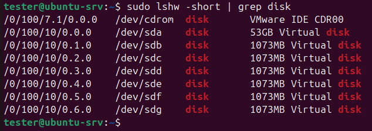

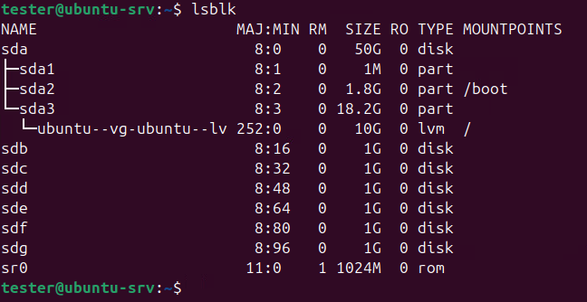

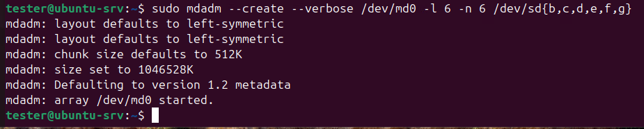

Проверим, что RAID собрался нормально:

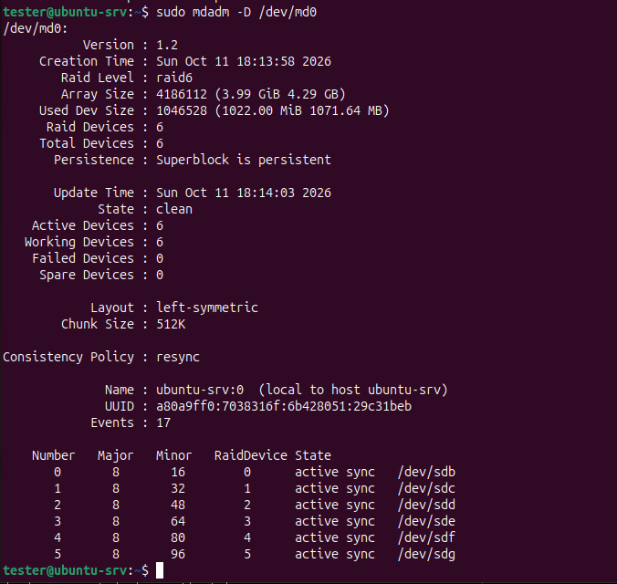

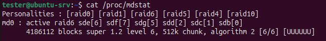

Сломать и починить RAID 

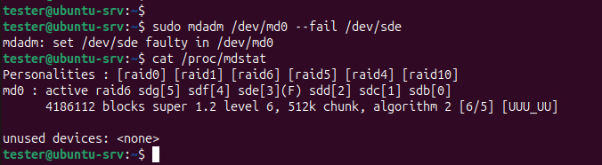

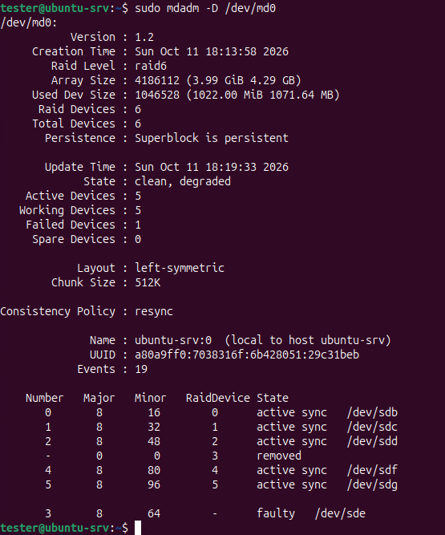

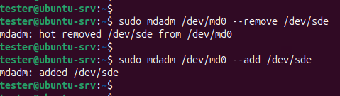

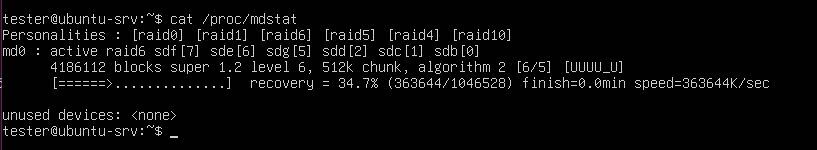

Создать GPT таблицу, пять разделов и смонтировать их в системе 

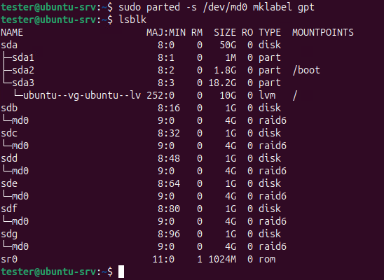

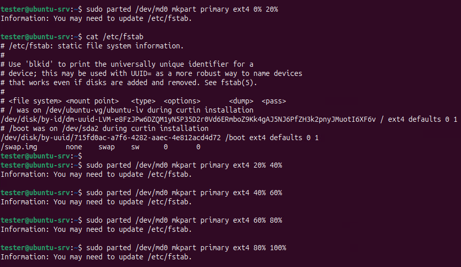

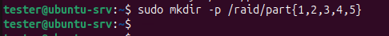

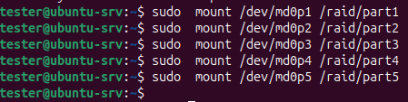

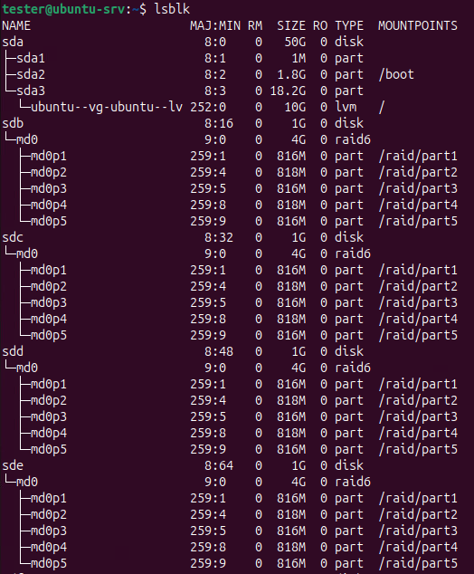
____________________________________
